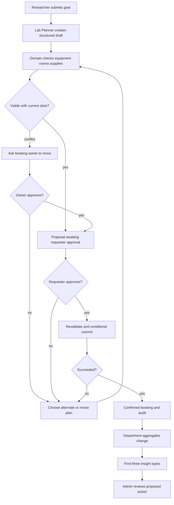

# 10 — State machines, interfaces, C3 workflow configuration guide

## Event flow from lab request to department insight



## Core state machines

`ExperimentPlan`: `draft → options_ready → approval_pending → ready_to_commit → committed`; plus `needs_revision`, `cancelled`, `failed`. Never assign `committed` before verified write result.

`ReservationProposal`: `draft → submitted → owner_approval_pending → requester_approval_pending → authorized → committed`; plus `rejected`, `stale`, `failed`. Proposals requiring no owner move can skip owner_approval_pending but **not** requester confirmation.

`OrderProposal`: `draft → awaiting_lab_approval → awaiting_fund_approval → approved_request`; `submitted_to_vendor` and `received` **not part of hackathon unless real integration verified**. In demo, treat as requisition/proposal, not purchase.

`DepartmentInsight`: `detected → reviewed → action_proposed → pending_approvals → approved` or `dismissed`; `executed` only if real backing operation and receipt exist.

## Suggested C3 workflow: `coordinate_experiment`

1. Input: `GoalRequest` plus resolved lab identity from access controls.
2. C3 agent/LLM node: parse goal into plan draft.
3. C3 Type or tool node: fetch resources/capabilities/stock.
4. Code/Type method node: schedule constraints and options.
5. User input/checkpoint: approve plan details or edit.
6. Conditional branch: if owner move needed, create liaison proposal and await authorized response.
7. User input/checkpoint: requester final approval.
8. Code/Type method node: conditional commit/compensation.
9. Post-action: persist audit, update read models, display receipt.

C3 platform 8.10 publicly documents workflow templates such as `C3 Type Input`, `LLM Caller`, `Code Execution`, `User Input`, `Update State`, `MCP Tool Execution`; actual node names/features vary by tenant. If an asynchronous external-inbox wait isn't supported by the workflow runtime, persist approval state in C3 Types and resume via app-side trigger with tested Type methods. **Do not fake an autonomous workflow**.

## Suggested workflow: `department_weekly_review`

1. Input week/department with admin identity, fetch permissible snapshots.
2. Compute metric materialization + baseline forecast.
3. Run three deterministic insights (pooling, overload, underuse).
4. Department agent turns structured results into readable recommendation cards.
5. Store insight version and analysis provenance.
6. Admin proposes selected action; notify impacted lab inboxes **in app**.
7. On required approvals, mark proposal approved — **no direct external procurement or scheduling**.

## Domain transport request/response examples

### Create plan draft (contract, not a platform REST path)

```json
{
  "requestId":"req_001",
  "labId":"lab_moreno",
  "actorId":"morgan",
  "goalText":"Image GFP-tagged cells Tuesday Nov 3 for 3 hours",
  "windowStartLocal":"2026-11-03T09:00:00-06:00",
  "deadlineLocal":"2026-11-04T18:00:00-06:00"
}
```

### Slot candidate response

```json
{
  "candidateId":"slot_moreno_confocal1_move_chen",
  "requestedBooking":{"resourceId":"confocal_1", "startLocal":"2026-11-03T10:00:00-06:00", "endLocal":"2026-11-03T13:00:00-06:00"},
  "hardConstraintStatus":"conditional",
  "conflictIds":["bk_chen_confocal"],
  "contingentMoves":[{"bookingId":"bk_chen_confocal", "newStartLocal":"2026-11-03T13:30:00-06:00", "newEndLocal":"2026-11-03T15:30:00-06:00"}],
  "approvalsRequired":["chen_owner", "morgan"],
  "qualificationsVerified":true,
  "assumptions":["15m cleaning buffer"]
}
```

### Department pooled order insight

```json
{
  "insightId":"pooled_antigfp_1",
  "type":"pooled_order",
  "sku":"ANTI_GFP_100",
  "labs":["lab_moreno","lab_patel"],
  "quantity":5,
  "beforeCostUSD":640,
  "afterCostUSD":545,
  "potentialSavingsUSD":95,
  "status":"detected",
  "realizedSavingsUSD":null,
  "requiredApprovals":["moreno_mgr","patel_mgr","dept_admin"],
  "assumptions":["synthetic vendor tier", "single pooled shipping destination", "finance policy approval"]
}
```

## API/adapter shape

These are **internal app interfaces**, not asserted C3 platform routes:

```text
DomainGateway:
  upsertSeed(scenarioId)
  getMyPlans(labId)
  parseGoal(goalRequest)
  evaluatePlan(planId)
  submitProposal(planId, optionId, idempotencyKey)
  recordApproval(proposalId, actorId, decision)
  commitProposal(proposalId, expectedVersions, idempotencyKey)
  getCalendar(filter)
  getDepartmentSnapshot(filter)
  recomputeInsights(week)
  getInsightDetail(insightId)
  getAuditEvents(entityId)
  resetDemoSandbox(scenarioId) [demoAdmin ONLY]
```

Implement `C3DomainGateway` using actual C3 Type methods/platform APIs per installed version. `LocalDomainGateway` can mirror contracts for offline work. UI consumes one gateway interface; **do not mix C3 and mock responses within the same live screen without labeling**. If using React separate from C3, no secrets in browser bundles; implement secure authentication and least-privilege API calls.

## Failure modes to expose

- `NOT_QUALIFIED` — show training/supervised alternative.
- `SLOT_STALE` — someone booked after we checked; refresh alternatives.
- `OWNER_REJECTED` — propose next-best option.
- `ORDER_TOO_LATE` — show earliest reliable supply readiness, revise experiment.
- `UNAUTHORIZED_APPROVAL` — don't reveal restricted details.
- `PARTIAL_COMMIT_RECOVERY` — show exact compensation/safely blocked state.
- `C3_UNAVAILABLE` — no fake success; labeled local-only backup.

Use structured error codes in UI. No silent exceptions, mock receipts or optimistic confirmation before acknowledgment.
